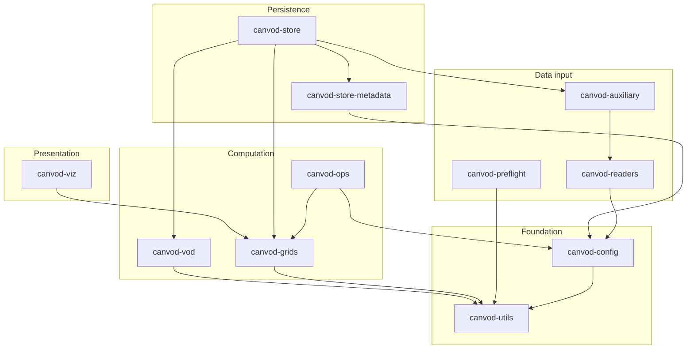

# Package dependencies

canVODpy is split into packages, and each package is in one layer. A
package depends only on packages of its own layer or of a lower one. This
page shows the dependencies between the packages, how many packages each
one depends on, and what each package needs when you install it on its
own. For what each layer does, see [Architecture](architecture.md).

The page lists the dependencies that each `pyproject.toml` declares under
`[project] dependencies`. Optional packages, such as `canvod-filemap` from
canvodpy-extensions, aren't part of it.

## Dependency graph

An arrow points from a package to a package it depends on. To keep the
graph readable, it leaves out `canvodpy`, which depends on all eleven
other packages, and every dependency that another path already implies:
for example, `canvod-store` also depends on `canvod-utils`, which it
reaches through `canvod-store-metadata` and `canvod-config`. The tables
below list every declared dependency.

## Coupling

12 packages, 32 dependencies between them.

| Layer | Package | Depends on (Ce) | Depended on by (Ca) | Instability |
|---|---|:-:|:-:|:-:|
| Foundation | `canvod-utils` | 0 | 9 | 0.00 |
| Foundation | `canvod-config` | 1 | 6 | 0.14 |
| Data input | `canvod-readers` | 2 | 3 | 0.40 |
| Data input | `canvod-auxiliary` | 3 | 2 | 0.60 |
| Data input | `canvod-preflight` | 1 | 1 | 0.50 |
| Computation | `canvod-vod` | 1 | 2 | 0.33 |
| Computation | `canvod-grids` | 1 | 4 | 0.20 |
| Computation | `canvod-ops` | 2 | 1 | 0.67 |
| Persistence | `canvod-store-metadata` | 2 | 2 | 0.50 |
| Persistence | `canvod-store` | 7 | 1 | 0.88 |
| Presentation | `canvod-viz` | 1 | 1 | 0.50 |
| Orchestration | `canvodpy` | 11 | 0 | 1.00 |

- **Ce**: the number of packages that this package depends on.
- **Ca**: the number of packages that depend on this package.
- **Instability**: Ce / (Ce + Ca). A package with 0 depends on no other
  package; a package with 1 has no package that depends on it.

`canvod-utils` and `canvod-config` have the most dependents (Ca = 9 and 6):
a change there affects the most packages.

## Install a package on its own

Each `canvod-*` package installs on its own, with the packages it needs.
For example, `uv add canvod-grids` also installs `canvod-utils`:

| Package | Needs, directly or through other packages |
|---|---|
| `canvod-utils` | nothing |
| `canvod-config` | `canvod-utils` |
| `canvod-readers` | `canvod-config`, `canvod-utils` |
| `canvod-auxiliary` | `canvod-config`, `canvod-readers`, `canvod-utils` |
| `canvod-preflight` | `canvod-utils` |
| `canvod-vod` | `canvod-utils` |
| `canvod-grids` | `canvod-utils` |
| `canvod-ops` | `canvod-config`, `canvod-grids`, `canvod-utils` |
| `canvod-store-metadata` | `canvod-config`, `canvod-utils` |
| `canvod-store` | `canvod-auxiliary`, `canvod-config`, `canvod-grids`, `canvod-readers`, `canvod-store-metadata`, `canvod-utils`, `canvod-vod` |
| `canvod-viz` | `canvod-grids`, `canvod-utils` |
| `canvodpy` | `canvod-auxiliary`, `canvod-config`, `canvod-grids`, `canvod-ops`, `canvod-preflight`, `canvod-readers`, `canvod-store`, `canvod-store-metadata`, `canvod-utils`, `canvod-viz`, `canvod-vod` |

## Checks

- `just check-package-imports` installs each package with only its
  declared dependencies and imports every module, so a dependency that a
  package uses but doesn't declare fails in CI.
- `just deps-report` prints the tables on this page, and `just
  deps-mermaid` prints the graph. Both read the `pyproject.toml` files and
  fail if a package depends on a package of a higher layer, or if a package
  has no layer in `scripts/analyze_dependencies.py`.
