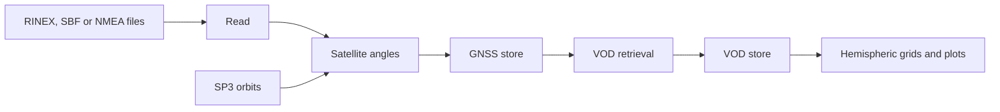

<h1 class="hero-logo">
  
  
</h1>

**An Open Python Ecosystem for GNSS-Transmissometry Canopy VOD Retrievals**

canVODpy aims to be the central community-driven software suite for
deriving canopy Vegetation Optical Depth (VOD) from the signal-to-noise
ratio of the same [GNSS](https://gssc.esa.int/navipedia/index.php/GNSS){:target="_blank"}
signal, received at the same time by one receiver below the canopy and one
with an unobstructed view of the sky.

[![VODnet](https://img.shields.io/badge/-VODnet-2d6a4f?labelColor=555555&logo=&logoColor=white)](https://www.gfz.de/en/section/remote-sensing-and-geoinformatics/projects/vodnet)

[Retrieve VOD from your GNSS data :fontawesome-solid-arrow-right:](users/index.md){ .md-button .md-button--primary }
[Contribute to canVODpy :fontawesome-solid-arrow-right:](CONTRIBUTING.md){ .md-button }
[See canVODpy at work in molab :fontawesome-solid-arrow-up-right-from-square:](https://molab.marimo.io/github/nfb2021/canvodpy-demo/blob/main/03_convenience_speedrun.py){ .md-button target=_blank }

---

## What makes canVODpy different

-   :fontawesome-solid-stamp: &nbsp; **One output for every file format**

    ---

    Reads RINEX v2.11, RINEX v3.04, stripped RINEX v3.05, NMEA v4.00 and
    Septentrio SBF. Every reader returns the same validated xarray Dataset,
    so the rest of canVODpy never depends on the file format.

    [:octicons-arrow-right-24: Reading GNSS files](packages/readers/overview.md)

-   :fontawesome-solid-database: &nbsp; **Versioned storage**

    ---

    Observations and VOD go into Icechunk stores. Every write is a commit
    that you can list, branch from and tag, like in git.

    [:octicons-arrow-right-24: Storage](packages/store/overview.md)

-   :fontawesome-solid-shield-halved: &nbsp; **No duplicates, no overlaps**

    ---

    Before it appends, canVODpy skips each file that's already in the
    store, by its SHA-256 hash, and each file whose time span overlaps data
    already stored.

    [:octicons-arrow-right-24: Storage](packages/store/overview.md)

-   :fontawesome-solid-globe: &nbsp; **Hemispheric grids**

    ---

    Seven grids divide the sky seen from the receiver into cells, among them
    equal-area, equal-angle, HEALPix, and geodesic grids. Each observation
    goes to the cell that contains it.

    [:octicons-arrow-right-24: Hemispheric grids](packages/grids/overview.md)

-   :fontawesome-solid-rotate: &nbsp; **Parallel by default**

    ---

    canVODpy reads and processes files in parallel worker processes, and
    sizes the workers to the machine, or to the limits you set.

    [:octicons-arrow-right-24: Parallel processing](guides/parallel-processing.md)

-   :fontawesome-solid-fingerprint: &nbsp; **Traceable**

    ---

    Each release has a DOI. Each store records where its data came from,
    in metadata that follows DataCite and ACDD, and a STAC catalog
    describes all stores.

    [:octicons-arrow-right-24: Store metadata](packages/store-metadata/overview.md)

---

## Processing pipeline

For SBF files, the satellite angles can also come from the files
themselves (`processing.params.ephemeris_source: broadcast`). For every
step of a run, see
[What a run does](architecture.md#what-a-run-does).

---

## Packages

-   :fontawesome-solid-book-open: &nbsp; **`canvod-readers`**

    ---

    Readers for the GNSS file formats, one output structure.

-   :fontawesome-solid-cloud-arrow-down: &nbsp; **`canvod-auxiliary`**

    ---

    Downloads SP3 orbits and CLK clocks and interpolates them to the
    epochs of the observations.

-   :fontawesome-solid-border-all: &nbsp; **`canvod-grids`**

    ---

    Hemispheric grids and the assignment of observations to their cells.

-   :fontawesome-solid-leaf: &nbsp; **`canvod-vod`**

    ---

    VOD from the zeroth-order tau-omega model, and the base class for
    other VOD calculators.

-   :fontawesome-solid-database: &nbsp; **`canvod-store`**

    ---

    The Icechunk stores for observations and VOD.

-   :fontawesome-solid-chart-line: &nbsp; **`canvod-viz`**

    ---

    2D polar plots and interactive 3D Plotly plots of the hemisphere.

-   :fontawesome-solid-sliders: &nbsp; **`canvod-config`**

    ---

    Reads and validates `canvod-settings.yaml`.

-   :fontawesome-solid-gear: &nbsp; **`canvod-utils`**

    ---

    Date utilities, diagnostics, and tools the other packages share.

-   :fontawesome-solid-circle-check: &nbsp; **`canvod-preflight`**

    ---

    The canVOD file name convention: parses and builds canonical
    names, finds files whose time spans overlap.

-   :fontawesome-solid-wand-magic-sparkles: &nbsp; **`canvod-ops`**

    ---

    Preprocessing steps applied before VOD, such as temporal aggregation.

-   :fontawesome-solid-stamp: &nbsp; **`canvod-store-metadata`**

    ---

    Writes, validates and exports the provenance metadata of a store.

-   :fontawesome-solid-circle-nodes: &nbsp; **`canvodpy`**

    ---

    The command line interface, `Site.pipeline()`, and the factories for
    readers, grids, and VOD calculators.

---

## Technology

!!! abstract "Scientific stack"

    `xarray` · `NumPy` · `SciPy` · `Polars`

!!! abstract "Storage"

    `Icechunk` · `Zarr`

!!! abstract "Code quality"

    `ruff` · `ty` · `pytest` · `uv`

!!! abstract "Documentation"

    `Zensical` · `mkdocstrings` · `Mermaid`

!!! abstract "AI-assisted development"

    [`Claude Code`](guides/ai-development.md) · project skills · `AGENTS.md`

---

## Affiliation

**Climate and Environmental Remote Sensing Research Unit (CLIMERS)**
Department of Geodesy and Geoinformation, TU Wien

[tuwien.at/en/mg/geo/climers](https://www.tuwien.at/en/mg/geo/climers){ .md-button }
