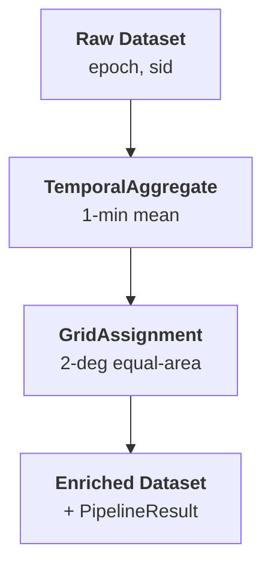

# canvod-ops

## Purpose

The `canvod-ops` package provides a preprocessing pipeline for observation
datasets. `canvodpy run`, the Python API and Airflow apply it before writing to
the GNSS store if the `processing.preprocessing` setting is set (see
[Preprocessing during a run](#preprocessing-during-a-run)); without that setting
the store holds the observations at the receiver's sampling interval. You can
also apply the operations yourself, for example to datasets read from a store.
Operations are applied as a chain: each operation receives a dataset,
transforms it, and passes the result to the next.

---

## Pipeline

A `Pipeline` is an ordered sequence of operations (`Op` instances). It processes
a dataset through each operation and collects metadata about what happened:

```python
from canvod.ops import Pipeline, TemporalAggregate, GridAssignment

pipeline = Pipeline(
    [
        TemporalAggregate(freq="1min", method="mean", integer_method="first"),
        GridAssignment(grid_type="equal_area", angular_resolution=2.0),
    ]
)

ds_out, result = pipeline(ds_in)

# result.to_metadata_dict() → stored in dataset attrs for reproducibility
```



---

## Built-in operations

### `TemporalAggregate`

Aggregates observations into regular time bins. Reduces the number of epochs by
grouping into frequency buckets and computing the mean or median of the
floating-point variables. Bins start at
multiples of `freq` counted from 00:00 and are labeled with their start.
Missing values (NaN, and -1 in integer variables) are ignored; a bin without
any value stays missing. Integer variables (for example `LLI` and `SSI`) are flags and
codes, which cannot be combined: each bin takes one of its values, the first,
last or middle one in time order (`integer_method`, required; of an even
number of values, `middle` takes the earlier of the two). The value of one
epoch stands for the bin, so a loss of lock in another epoch of the bin is
not seen. A bin keeps no count of the epochs behind it.

The result has the same variables, dimensions, data types, attributes and
encodings as the input, with fewer epochs, so aggregated data cannot be told
apart from unaggregated data by their structure. What was done is reported in
the `result` of the returned `OpResult` instead, for example
`{"aggregated": true, "input_sampling_s": 5.0, "output_sampling_s": 60.0}`,
and kept in the stores' log books (see
[The preprocessing record](#the-preprocessing-record)). The aggregation runs on
NumPy arrays in blocks of bins of bounded size; a day of 1 s data with 300
signals takes about one second.

`SNR` is averaged as stored, in dB-Hz, not as linear power. Because VOD is
linear in the SNR difference in dB, the mean of the dB values gives the mean of
the per-epoch VOD if the canopy and reference bins average the same
epochs and $\theta$ changes little within a bin
([issue #192](https://github.com/nfb2021/canvodpy/issues/192)). The median is
the same in dB and in linear power.

Measured on one day of the Rosalia test data (5 s, 271 signals), against the
mean of the per-epoch VOD (mean |VOD| 0.88):

| Bin | $\theta$ change in a bin (p95) | VOD error from $\theta$ (mean / p95) | VOD error, receivers aggregated separately (mean / p95 / max) |
|---|---|---|---|
| 30 s | $0.20^\circ$ | 0.0001 / 0.0005 | 0.0015 / 0.009 / 0.15 |
| 1 min | $0.45^\circ$ | 0.0003 / 0.0012 | 0.0017 / 0.009 / 0.44 |
| 5 min | $2.4^\circ$ | 0.0015 / 0.0048 | 0.0036 / 0.012 / 0.40 |
| 15 min | $7.2^\circ$ | 0.0041 / 0.013 | 0.013 / 0.066 / 0.59 |

$\theta$ within a bin matters little up to a few minutes. The larger error comes
from bins in which the canopy and the reference receiver have values at
different epochs (for example a satellite tracked by one receiver for part of the
bin): a run aggregates each receiver on its own, so such bins average
different epochs. A bin also keeps no count of the epochs behind it, so a
bin with one value weighs like a full one in later averages.

```python
from canvod.ops import TemporalAggregate

op = TemporalAggregate(freq="1min", method="mean", integer_method="first")
ds_out, result = op(ds_in)
```

| Parameter | Default | Description |
|-----------|---------|-------------|
| `freq` | `"1min"` | Target frequency (pandas offset alias) |
| `method` | `"mean"` | Floating-point variables: `"mean"` or `"median"` |
| `integer_method` | required | Integer variables: `"first"`, `"last"` or `"middle"` value of the bin |

If every epoch already is the start of its own bin, the operation is a no-op:
it returns the dataset unchanged and reports `"aggregated": false`. Data at the
target interval but off the bin starts (for example epochs at `:02`) are relabeled to
the bin starts.

#### Per-SID independence

`TemporalAggregate` groups by `(time_bin, sid)` before computing the aggregate.
This is critical because each SID (satellite + band + code) observes the canopy
from a different sky position ($\theta$, $\varphi$). Mixing VOD or SNR values across satellites
within a time bin conflates spatial variability (different view angles) with
temporal variability, which gives a physically meaningless average.

Geometry ($\theta$, $\varphi$) is aggregated per SID with the same method, so it describes
where the aggregated value came from; `.first()` would instead assign a single
observation's geometry to it. The azimuth $\varphi$ is aggregated as an angle: each
value is taken relative to the first value of its bin, so a satellite crossing
north ($\varphi = 0$) yields north, not south.

Coordinate handling:

| Coordinate type | Example | Aggregation |
|----------------|---------|-------------|
| Data variables | `VOD`, `SNR` | Mean or median per `(time_bin, sid)` |
| Geometry | `theta` | Mean or median per `(time_bin, sid)` |
| Azimuth | `phi` | Mean or median as an angle per `(time_bin, sid)` |
| SID-only coordinates | `sv`, `band`, `code` | Preserved unchanged |

!!! warning "Anti-pattern: naive xarray resampling"
    A plain `ds.resample(epoch="1D").mean()` preserves the `sid` dimension
    (xarray resamples along `epoch` only), so per-SID independence is maintained.
    However, it does not distinguish between data variables and geometry
    coordinates, and does not handle SID-only coordinates explicitly.
    For production use, prefer `TemporalAggregate`.

### `GridAssignment`

Assigns each observation to the grid cell that contains its direction
(`phi`, `theta`); an observation outside every cell gets NaN. The grid is built
with `create_hemigrid` and its defaults (see
[canvod-grids](../grids/overview.md)). Adds a `cell_id_*` variable to the
dataset.

```python
from canvod.ops import GridAssignment

op = GridAssignment(grid_type="equal_area", angular_resolution=2.0)
ds_out, result = op(ds_in)
# ds_out now has cell_id_equal_area_2.0deg(epoch, sid)
```

| Parameter | Default | Description |
|-----------|---------|-------------|
| `grid_type` | `"equal_area"` | Grid builder name |
| `angular_resolution` | `2.0` | Resolution in degrees |

`phi` and `theta` may be data variables (as the runs write them) or
coordinates, on `(epoch, sid)`. If either is missing, the operation is skipped
with a warning.

---

## `Op` and `OpResult`

All operations inherit from the `Op` abstract base class:

```python
from canvod.ops import Op, OpResult


class MyOp(Op):
    @property
    def name(self) -> str:
        return "my_operation"

    def __call__(self, ds: xr.Dataset) -> tuple[xr.Dataset, OpResult]:
        # transform ds
        return ds, OpResult(
            op_name=self.name,
            parameters={...},
            input_shape=dict(ds.sizes),
            output_shape=dict(ds.sizes),
            duration_seconds=elapsed,
        )
```

Each `OpResult` records:

- Operation name and parameters (the settings)
- `result`: what the operation measured or derived (for example the input sampling)
- Input/output dataset dimensions
- Execution time
- Optional notes (for example "no-op: data already at target frequency")

`OpResult.step()` gives the operation's entry in the preprocessing record,
`{"op", "settings", "result"}`, and `PipelineResult.record()` the record of
all operations in the order they ran. A new operation therefore records itself:
it only has to fill `parameters` and `result`. If it runs code of another
package, it names that package in `packages` (`GridAssignment` sets
`packages = ("canvod-ops", "canvod-grids")`), so the record gives its version
too.

---

## Preprocessing during a run

`canvodpy run`, the Python API and Airflow apply the operations set in the
`processing.preprocessing` section of `canvod-settings.yaml`. Nothing is
applied unless the section is set, and each operation runs only if its own
subsection is set (and not `enabled: false`):

```yaml
processing:
  preprocessing:
    temporal_aggregation:
      freq: "1min"      # whole number + "s", "min" or "h"; must divide one day
      method: "median"  # "mean" or "median", floating-point variables
      integer_method: "first"  # "first", "last" or "middle", integer variables
    grid_assignment:
      grid_type: "equal_area"
      angular_resolution: 2.0
```

The temporal aggregation runs first, then the grid cell assignment. Both run on
all files of one receiver and day together (`preprocess_files`), after azimuth
and elevation are computed and before the data goes to the GNSS store.
A time bin that spans two files is therefore aggregated from the observations of
both; it is stored with the file that holds its first observation. Each
stored file keeps its own attributes (for example the file hash) and all `sid`
coordinates. VOD is then
computed from the aggregated data and carries the `cell_id_*` variables along.

### The preprocessing record

For traceability, transparency and reproducibility, every write records which
preprocessing produced the data. The record is written by the operations
themselves and has this form (here for one day of 5 s data):

```json
{
  "format_version": 2,
  "software": {"canvod-grids": "1.0.0", "canvod-ops": "1.0.0"},
  "steps": [
    {
      "op": "temporal_aggregate",
      "settings": {"freq": "1min", "method": "mean"},
      "result": {"aggregated": true, "input_sampling_s": 5.0, "output_sampling_s": 60.0}
    },
    {
      "op": "grid_assign",
      "settings": {"grid_type": "equal_area", "angular_resolution": 2.0},
      "result": {"assigned": true, "variable": "cell_id_equal_area_2.0deg", "n_cells": 6563}
    }
  ]
}
```

`format_version` is the version of the record's layout, not of the software.
`software` gives the version of every package whose code ran the operations
(canVODpy packages are released separately): canvod-ops always, canvod-grids
when cells were assigned. Records of format 1, written by canVODpy up to
0.4.0, name only the canvod-ops version (`canvod_ops_version`) and are still
read.
Without `processing.preprocessing`, `steps` is empty, which records that no
preprocessing was applied.

The record is kept in the log books of the stores, never in the data: stored
data have exactly the variables and attributes of data without preprocessing.

- **GNSS store**: the `preprocessing` column of `{group}/metadata/table` holds
  the record of each file, written in the same commit as the file's data.
- **VOD store**: the `preprocessing` column of the analysis group's log book
  holds, per receiver, the records of the GNSS data the result was computed
  from, for example `{"canopy_01": [record], "reference_01": [record]}`.
- **Store history**: the commit log of the store. Each commit records its
  settings, among them the preprocessing, and the canVODpy version in its
  commit metadata; `canvod.store_metadata.show_metadata` lists the commits.

A store group never mixes data preprocessed with different operations or
settings. Before each write, the store compares the settings of the new data
with every record in the group's log book; the results may differ (for example data
at 1 s and at 5 s, both aggregated to 1 min). A VOD result is computed only
from canopy and reference data preprocessed with the same settings. On a
mismatch, the write raises `PreprocessingMismatchError` and `canvodpy run`
stops with exit code 1, since every later day would be refused the same way:
keep the setting for the life of a store, or start a new store.

`canvodpy run` makes the same comparison before it processes any data: the
configured `processing.preprocessing` against every GNSS group the run writes
and every VOD analysis group of the selected calculator. A mismatch therefore
stops the run at once, also when a new GNSS store would feed an existing VOD
store. `canvod.ops.planned_settings(config)` gives the settings a
configuration records, and `MyIcechunkStore.check_settings_match` compares
them with a group.

### Adding grid cells to stored data

Data written without `grid_assignment` can get their cells afterwards, for a
GNSS receiver group or a VOD analysis group:

```python
from canvod.ops import assign_grid_cells_in_store

assign_grid_cells_in_store(
    site.gnss_store, "canopy_01", grid_type="equal_area", angular_resolution=2.0
)
```

It runs the same operation as `grid_assignment` in a run on all data of the
group and writes only the new `cell_id_*` variable; the data, the log book and
the other subgroups stay as they are. The log book receives one row for the
whole group (action `add_variables`, no time range) whose record holds the
`grid_assign` step. From then on, the data already in the group count as
preprocessed with that step as well:

- A later run must set `grid_assignment` to the same `grid_type` and
  `angular_resolution`; its data then carry the cells, and the append goes
  through. A run without it is refused with `PreprocessingMismatchError`.
- A VOD analysis group accepts only VOD computed from GNSS data with the same
  grid assignment: assign the cells to the receiver groups too, or compute the
  VOD again from them.

An append whose variables differ from the group's (for example data without the
`cell_id_*` variable of the group) is refused in any case
(`GroupVariablesMismatchError`, which also stops a run): the variable would no
longer be as long as the others, and the group could no longer be opened.

`build_default_pipeline(config)` builds the same pipeline from a
`PreprocessingConfig`; called without one, it reads the setting.
