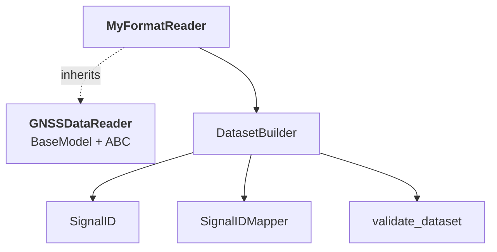

# Build a reader

This guide shows how to write a reader for a GNSS file format that
canVODpy does not read yet. The result is a validated dataset that
`canvod-store`, `canvod-auxiliary`, and `canvod-vod` accept like the output of
the built-in readers.

To use the reader in `canvodpy run`, install it as a plugin (see
[Your own readers and VOD calculators](../../guides/plugins.md)). To add it
to canVODpy itself, also follow [Add it to canVODpy](#add-it-to-canvodpy).

You should know [xarray datasets](https://docs.xarray.dev/),
[Pydantic models](https://docs.pydantic.dev/) and Python's
[abstract base classes](https://docs.python.org/3/library/abc.html).

---

## The reader contract

Every reader inherits from `GNSSDataReader` (`canvod.readers.base`), a
Pydantic `BaseModel` and an abstract base class in one. One parent is
enough:



A reader must:

1. Implement the abstract members: `source_format`, `file_hash`,
   `start_time`, `end_time`, `systems`, `num_satellites` (properties) and
   `iter_epochs()`, `to_ds()` (methods). A reader that misses one cannot be
   created.
2. Set the class attribute `file_type`: the TYPE field of the files'
   canVOD names, for example `"rnx"`.
3. Return from `to_ds()` a dataset that passes `validate_dataset()`.

The base class gives every reader:

| Member | What it does |
|---|---|
| `fpath` | The path of the file; construction raises `FileNotFoundError` if it is not a file |
| `aggregate_glonass_fdma` | Whether GLONASS FDMA channels are merged into the bands `G1` and `G2` (default `True`); see [GLONASS FDMA channels](#glonass-fdma-channels) |
| `model_config` | `arbitrary_types_allowed=True` |
| `_build_attrs()` | The required global attributes; author and institution come from the settings file |
| `num_epochs` | Counts the epochs of `iter_epochs()`; override it if the header stores the count |
| `to_ds_and_auxiliary()` | Calls `to_ds()` and returns no auxiliary datasets; see [Return auxiliary data](#return-auxiliary-data-optional) |

### The output dataset

`validate_dataset(ds)` checks the dataset against constants in
`canvod.readers.base` and raises one `ValueError` that lists every
problem it finds:

| Constant | Value |
|---|---|
| `REQUIRED_DIMS` | `("epoch", "sid")` |
| `REQUIRED_COORDS` | `epoch` (`datetime64[ns]`); `sid`, `sv`, `system`, `band`, `code` (strings); `freq_center`, `freq_min`, `freq_max` (`float32`, MHz) |
| `DEFAULT_REQUIRED_VARS` | `["SNR"]`; every data variable has the dimensions `(epoch, sid)` |
| `REQUIRED_ATTRS` | `Created`, `Software`, `Institution`, `File Hash` |

`epoch` holds one entry per observation epoch, in GPS time (its attribute
`time_system` says so). `sid` holds one entry per signal, written
`SV|band|code`, for example `G01|L1|C`; `sv`, `system`, `band` and `code`
split it up. The store uses `File Hash` to refuse a file it already holds,
and the band overlap checks use the frequency coordinates.

`DatasetBuilder` produces all of this. With it, a reader only parses its
format.

---

## Create the class

```python
from pydantic import ConfigDict

from canvod.readers.base import GNSSDataReader


class MyFormatReader(GNSSDataReader):
    """Reader for .myf files."""

    model_config = ConfigDict(frozen=True)
    file_type = "myf"

    @property
    def source_format(self) -> str:
        return "my_format"
```

`source_format` names the format; the GNSS store records it. The built-in
readers return `rinex3`, `rinex3_stripped`, `rinex2`, `sbf` and `nmea`.

The base class does not freeze readers. `frozen=True` stops anyone from
changing `fpath` or another field after construction; the RINEX readers use
it, `SbfReader` and `NmeaObs` do not. `@cached_property` works either way.

If the format needs settings, add them as fields:

```python
from pydantic import PrivateAttr


class MyFormatReader(GNSSDataReader):
    model_config = ConfigDict(frozen=True)
    file_type = "myf"

    skip_header: bool = False  # a field, set at construction
    _cache: dict = PrivateAttr(default_factory=dict)  # not part of the model
```

!!! warning "Do not declare `fpath` again"

    `fpath` comes from `GNSSDataReader`. Declaring it again replaces the
    field and its check that the file exists.

---

## Hash the file

The store compares `file_hash` with the hashes of the files it already
holds, so the same file must always give the same hash. Use the shared
function, as every built-in reader does:

```python
from canvod.utils.tools import file_hash


class MyFormatReader(GNSSDataReader):
    ...

    @property
    def file_hash(self) -> str:
        """First 16 characters of the SHA-256 of the file."""
        return file_hash(self.fpath)
```

It reads the file in 8 KB chunks. A reader that holds the whole file in
memory anyway can call `canvod.utils.tools.bytes_hash(data)`, which gives
the same value without reading the file again.

---

## Describe the file

These properties summarize the file without building the dataset:

```python
from datetime import datetime
from functools import cached_property


class MyFormatReader(GNSSDataReader):
    ...

    @cached_property
    def _header(self):
        return self._parse_header()  # parsed once, on first use

    @property
    def start_time(self) -> datetime:
        return self._header.start_time

    @property
    def end_time(self) -> datetime:
        return self._header.end_time

    @property
    def systems(self) -> list[str]:
        """System letters, for example ["G", "E", "R"]."""
        return self._header.systems

    @property
    def num_satellites(self) -> int:
        return self._header.num_satellites
```

---

## Iterate over the epochs

`iter_epochs()` yields one epoch at a time, so a large file never has to
fit in memory. What an epoch looks like is up to the reader; the base
class types it as `object`. A named tuple is enough:

```python
from collections.abc import Iterator
from typing import NamedTuple


class MyObservation(NamedTuple):
    sv: str  # "G01"
    band: str  # "L1"
    code: str  # "C"
    snr: float


class MyEpoch(NamedTuple):
    timestamp: datetime
    observations: list[MyObservation]


class MyFormatReader(GNSSDataReader):
    ...

    def iter_epochs(self) -> Iterator[MyEpoch]:
        with self.fpath.open("rb") as f:
            self._skip_header(f)
            while (epoch := self._read_next_epoch(f)) is not None:
                yield epoch
```

---

## Build the dataset

`DatasetBuilder` (`canvod.readers.builder`) turns epochs and values into
the output dataset:

```python
import xarray as xr

from canvod.readers.builder import DatasetBuilder


class MyFormatReader(GNSSDataReader):
    ...

    def to_ds(self, keep_data_vars: list[str] | None = None, **kwargs) -> xr.Dataset:
        builder = DatasetBuilder(
            self,
            time_system="GPS",
            aggregate_glonass_fdma=self.aggregate_glonass_fdma,
        )
        for epoch in self.iter_epochs():
            ei = builder.add_epoch(epoch.timestamp)
            for obs in epoch.observations:
                sig = builder.add_signal(sv=obs.sv, band=obs.band, code=obs.code)
                builder.set_value(ei, sig, "SNR", obs.snr)
        return builder.build(
            keep_data_vars=keep_data_vars,
            extra_attrs={"Source Format": "My Custom Format"},
        )
```

| Method | What it does |
|---|---|
| `DatasetBuilder(reader, time_system=..., aggregate_glonass_fdma=True)` | Starts a dataset. `time_system` must be `"GPS"`; anything else raises `ValueError` |
| `add_epoch(timestamp)` | Adds an epoch and returns its index |
| `add_signal(sv, band, code)` | Returns the `SignalID`; adding the same signal again changes nothing |
| `set_value(epoch_index, signal, variable, value)` | Sets one value |
| `build(keep_data_vars=None, extra_attrs=None)` | Builds the dataset, validates it, and returns it |

`build()`:

1. sorts the signals by their `sid` string;
2. looks up `freq_center` of each band with `SignalIDMapper`, and sets
   `freq_min` and `freq_max` to the center frequency minus and plus half
   the bandwidth, all as `float32`;
3. fills every value you did not set with NaN for floating-point variables
   and `-1` for integer ones;
4. adds the metadata of the coordinates and of the variables it knows;
5. adds the global attributes of `_build_attrs()` and `extra_attrs`;
6. calls `validate_dataset()`.

It knows these variables:

| Variable | Type | Meaning |
|---|---|---|
| `SNR` | `float32` | Signal-to-noise ratio (dB) |
| `CN0` | `float32` | Carrier-to-noise density (dB-Hz) |
| `Pseudorange` | `float64` | Pseudorange (m) |
| `Phase` | `float64` | Carrier phase (cycles) |
| `Doppler` | `float32` | Doppler shift (Hz) |
| `LLI` | `int8` | Loss of lock indicator |
| `SSI` | `int8` | Signal strength indicator |

Other names are stored as `float32`, without metadata.

!!! warning "Unknown bands"

    A band that `SignalIDMapper` does not know gets NaN for `freq_center`,
    `freq_min` and `freq_max`, without an error. Check the frequency
    coordinates of your first dataset.

### Epochs in GPS time

canVODpy stores every epoch in GPS time, the time scale of the orbits and
clocks. The builder stores each timestamp as given and drops its time
zone without converting it. Convert other time scales before
`add_epoch()`:

```python
from datetime import UTC

from canvod.readers.gnss_specs.leap_seconds import utc_to_gps

# UTC or local time: convert to UTC, then add the leap seconds of the date
builder.add_epoch(utc_to_gps(local_timestamp.astimezone(UTC)))
```

GPS time is ahead of UTC by the leap seconds since 1980, 18 seconds since
2017.

### GLONASS FDMA channels

GLONASS satellites send on their own frequency channels. With
`aggregate_glonass_fdma=True` (the default), the builder merges them into
the bands `G1` and `G2`: the center frequency is the mean of the channels,
and the band reaches across all of them. With `False`, the bands are
`G1_FDMA` and `G2_FDMA`.

A run passes `processing.params.aggregate_glonass_fdma` to the reader, to
the padding of the signals (`pad_to_global_sid`) and to the orbit data
(`prep_aux_ds`), so the GLONASS signals of observations and orbits match.
A reader that only has merged bands sets the class attribute
`per_channel_glonass = False` (the default): the base class then refuses
`aggregate_glonass_fdma=False`.

---

## Return auxiliary data (optional)

If the format holds more than observations, such as satellite angles or
quality indicators, override `to_ds_and_auxiliary()` to read both in one
pass over the file. It returns the observation dataset and a dictionary
of auxiliary datasets:

```python
def to_ds_and_auxiliary(
    self, keep_data_vars: list[str] | None = None, **kwargs
) -> tuple[xr.Dataset, dict[str, xr.Dataset]]:
    obs_ds, meta_ds = self._read_once(keep_data_vars)
    return obs_ds, {"my_format_meta": meta_ds}
```

`SbfReader` returns its metadata this way, as `sbf_obs`: the satellite
geometry the receiver computed and its quality data of each epoch.

---

## Signal IDs

`SignalID` checks each part of a signal ID when it is created. It is
frozen and hashable, so it works as a dictionary key:

```python
from canvod.readers.base import SignalID

sig = SignalID(sv="G01", band="L1", code="C")
sig.sid  # "G01|L1|C", also str(sig)
sig.system  # "G"
SignalID.from_string("E25|E5a|I")

SignalID(sv="X01", band="L1", code="C")  # ValueError: no system X
SignalID(sv="G1", band="L1", code="C")  # ValueError: two digits needed
```

The satellite is a system letter, `G` (GPS), `R` (GLONASS), `E` (Galileo),
`C` (BeiDou), `J` (QZSS), `S` (SBAS) or `I` (NavIC/IRNSS), and two digits.

Band names must be ones that `SignalIDMapper` knows, for example:

| System | Bands |
|---|---|
| GPS | `L1`, `L2`, `L5` |
| Galileo | `E1`, `E5a`, `E5b`, `E5`, `E6` |
| GLONASS | `G1`, `G2`, `G3`, `G1a`, `G2a` |
| BeiDou | `B1I`, `B1C`, `B2a`, `B2b`, `B3I` |
| QZSS | `L1`, `L2`, `L5`, `L6` |

Codes are the RINEX 3 tracking codes (`C`, `P`, `W`, `I`, `Q`, `X` and
others); the builder does not check them. Never guess a code your format
does not record: the lowercase markers `p`, `l` and `u` exist for that
case (see [RINEX v2.11](rinex-v2-format.md#lowercase-tracking-code-markers)).
Padding to all signals (`pad_to_global_sid()`) drops any other code that
is not a RINEX 3 code.

---

## Test the reader

Keep a small sample file with the tests. Test the contract, not only the
values:

```python
from pathlib import Path

import numpy as np
import pytest

from canvod.readers.base import validate_dataset
from my_canvod_plugin import MyFormatReader

SAMPLE = Path(__file__).parent / "test_data" / "sample.myf"


@pytest.fixture
def reader():
    return MyFormatReader(fpath=SAMPLE)


def test_missing_file_refused(tmp_path):
    with pytest.raises(FileNotFoundError):
        MyFormatReader(fpath=tmp_path / "missing.myf")


def test_file_hash(reader):
    assert reader.file_hash == MyFormatReader(fpath=SAMPLE).file_hash
    assert len(reader.file_hash) == 16


def test_dataset_passes_contract(reader):
    ds = reader.to_ds()
    validate_dataset(ds)
    assert ds.attrs["File Hash"] == reader.file_hash
    assert ds["freq_center"].dtype == np.float32
    assert not np.isnan(ds["freq_center"]).any()  # every band known


def test_keep_data_vars(reader):
    assert list(reader.to_ds(keep_data_vars=["SNR"]).data_vars) == ["SNR"]


def test_summary(reader):
    assert reader.start_time <= reader.end_time
    assert set(reader.systems) <= set("GRECJSI")
    assert reader.num_satellites > 0
```

Also compare a few values with what the receiver's own software shows for
the same file.

---

## Register and create

`ReaderFactory` creates readers by name:

```python
from canvodpy import ReaderFactory

ReaderFactory.register("my_format", MyFormatReader)
reader = ReaderFactory.create("my_format", fpath="data.myf")
```

Registering in a script makes the reader available to that script only.
`canvodpy run` uses the readers that ship with canVODpy and installed
plugins.

`ReaderFactory.create_from_file(path)` and `detect_reader(path)` pick a
built-in reader from the file: NMEA by the `.nmea` extension or a first
line starting with `$`, RINEX 2 or 3 by the version in the first header
line. A RINEX 3 file with signal strengths only gets `rinex3_stripped`.
Other files raise `ValueError`; SBF is created by name. A registered
reader is never detected.

A run whose receiver sets `reader_format: auto` tells SBF and NMEA files by
their canVOD file type, and RINEX 2 from RINEX 3 with `detect_reader()`. It
uses the full RINEX 3 reader for stripped files too.

---

## Add it to canVODpy

A reader that ships with canVODpy goes into its own folder in
canvod-readers:

```
packages/canvod-readers/
├── src/canvod/readers/
│   ├── __init__.py       # export MyFormatReader
│   └── my_format/
│       ├── __init__.py
│       └── reader.py
└── tests/
    ├── test_my_format_reader.py
    └── test_data/sample.myf
```

`canvodpy run` knows its built-in formats by name. A new one needs all of
these; they list the formats, so keep them in step:

| Where | What |
|---|---|
| `canvodpy/src/canvodpy/__init__.py` | Register the reader in `_register_builtin_components` |
| `canvodpy/src/canvodpy/factories.py` | `ReaderFactory._detect_format`, if `reader_format: auto` should find it |
| `canvodpy/src/canvodpy/orchestrator/discovery.py` | `_READER_FILE_TYPES`, `_ALL_FILE_TYPES` |
| `packages/canvod-preflight/src/canvod/preflight/convention.py` | `FileType`, if the file type is new |
| `packages/canvod-config/src/canvod/config/models/sites.py` | The `reader_format` values and description; `_FILE_FORMAT` if the reader reads the files of another format (as `rinex3_stripped` reads RINEX 3), so a canopy and its reference count as the same format |
| `packages/canvod-store/src/canvod/store/viewer.py` | `_FORMAT_LABELS` |

The built-in readers predate `DatasetBuilder`: each assembles its dataset
itself and calls `validate_dataset()` at the end of `to_ds()`. A new
reader should use the builder.

---

## Complete example

A reader for a made-up text format, with epochs in UTC:

```python
"""Reader for .gnsd files (GNSS Simple Data, a made-up format).

GNSD 1.0
EPOCH 2025-01-01T00:00:00Z
G01 L1 C 42.5
E01 E1 C 40.1
EPOCH 2025-01-01T00:00:30Z
G01 L1 C 43.0
END
"""

from collections.abc import Iterator
from datetime import datetime
from functools import cached_property
from typing import NamedTuple

import xarray as xr

from canvod.readers.base import GNSSDataReader
from canvod.readers.builder import DatasetBuilder
from canvod.readers.gnss_specs.leap_seconds import utc_to_gps
from canvod.utils.tools import file_hash


class GnsdObservation(NamedTuple):
    sv: str
    band: str
    code: str
    snr: float


class GnsdEpoch(NamedTuple):
    timestamp: datetime  # GPS time
    observations: list[GnsdObservation]


class GnsdReader(GNSSDataReader):
    file_type = "gnsd"

    @property
    def source_format(self) -> str:
        return "gnsd"

    @property
    def file_hash(self) -> str:
        return file_hash(self.fpath)

    def iter_epochs(self) -> Iterator[GnsdEpoch]:
        timestamp, observations = None, []
        with self.fpath.open() as f:
            next(f)  # the line "GNSD 1.0"
            for line in f:
                parts = line.split()
                if parts[0] in ("EPOCH", "END") and timestamp is not None:
                    yield GnsdEpoch(timestamp, observations)
                if parts[0] == "END":
                    return
                if parts[0] == "EPOCH":
                    # "Z": UTC. canVODpy stores GPS time.
                    utc = datetime.fromisoformat(parts[1].replace("Z", "+00:00"))
                    timestamp, observations = utc_to_gps(utc), []
                else:
                    sv, band, code, snr = parts
                    observations.append(GnsdObservation(sv, band, code, float(snr)))

    def to_ds(self, keep_data_vars: list[str] | None = None, **kwargs) -> xr.Dataset:
        builder = DatasetBuilder(self, time_system="GPS")
        for epoch in self.iter_epochs():
            ei = builder.add_epoch(epoch.timestamp)
            for obs in epoch.observations:
                sig = builder.add_signal(sv=obs.sv, band=obs.band, code=obs.code)
                builder.set_value(ei, sig, "SNR", obs.snr)
        return builder.build(
            keep_data_vars=keep_data_vars, extra_attrs={"Source Format": "GNSD 1.0"}
        )

    @cached_property
    def _epochs(self) -> list[GnsdEpoch]:
        epochs = list(self.iter_epochs())
        if not epochs:
            raise ValueError(f"No epochs in {self.fpath}")
        return epochs

    @property
    def start_time(self) -> datetime:
        return self._epochs[0].timestamp

    @property
    def end_time(self) -> datetime:
        return self._epochs[-1].timestamp

    @property
    def systems(self) -> list[str]:
        return sorted({o.sv[0] for e in self._epochs for o in e.observations})

    @property
    def num_satellites(self) -> int:
        return len({o.sv for e in self._epochs for o in e.observations})
```

---

## Common mistakes

| Mistake | Result | Instead |
|---|---|---|
| Building the dataset by hand | Wrong dimension names or `float64` frequencies fail `validate_dataset()`, or nothing checks the dataset at all | Use `DatasetBuilder` |
| Epochs in UTC or local time | Off by the leap seconds (18 s since 2017) or the time zone | Convert with `utc_to_gps()` before `add_epoch()` |
| `class MyReader(GNSSDataReader, BaseModel)` | Nothing gained; `GNSSDataReader` is a `BaseModel` | One parent |
| `fpath: Path` in the reader | The check that the file exists is lost | Inherit `fpath` |
| `ds.dims["epoch"]` for a length | `FutureWarning` from xarray | `ds.sizes["epoch"]` |

---

## Imports

```python
from canvod.readers.base import GNSSDataReader, SignalID, validate_dataset
from canvod.readers.builder import DatasetBuilder
from canvod.readers.gnss_specs.leap_seconds import utc_to_gps
from canvod.readers.gnss_specs.signals import SignalIDMapper
from canvod.utils.tools import file_hash
from canvodpy import ReaderFactory
```

See also [RINEX v3.04](rinex-format.md), [SBF](sbf.md), and the
[API reference](../../api/canvod-readers.md).
