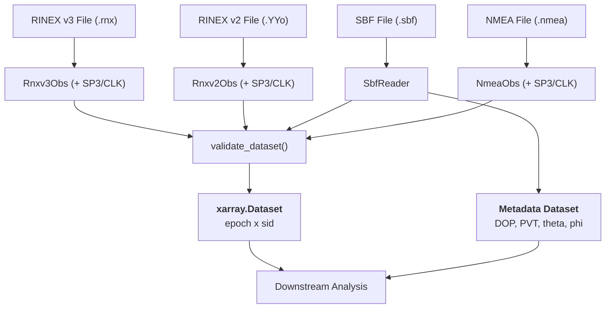

# canvod-readers

## Purpose

The `canvod-readers` package provides validated parsers for [GNSS](https://gssc.esa.int/navipedia/index.php/GNSS){:target="_blank"} observation data. It transforms raw receiver files into analysis-ready [xarray Datasets](https://docs.xarray.dev){:target="_blank"}, serving as the data ingestion layer for GNSS Transmissometry (GNSS-T) analysis.
!!! note "Storage stack"

    [**xarray**](https://docs.xarray.dev){:target="_blank"} provides labeled N-D arrays with named axes and coordinates, like NumPy with named dimensions and attached metadata. Readers output xarray Datasets that flow into [**Zarr**](https://zarr.dev){:target="_blank"}, a chunked, compressed array format designed for parallel cloud reads. [**Icechunk**](https://icechunk.io){:target="_blank"} sits on top of Zarr and adds git-like version control: every append is a commit-snapshot retrievable by ID. Together they form part of the [**Pangeo**](https://pangeo.io){:target="_blank"} open scientific Python ecosystem for large geoscience datasets that canvodpy builds on.

<div class="grid cards" markdown>

-   :fontawesome-solid-file-lines: &nbsp; **RINEX v3.04 (`Rnxv3Obs`)**

    ---

    [RINEX](https://igs.org/wg/rinex/){:target="_blank"} (Receiver Independent Exchange Format) is the IGS-standardized
    plain-text format for GNSS observations, supported by every major receiver manufacturer.
    Observation files (`.rnx`) contain timestamped pseudorange, carrier phase, Doppler, and
    signal-to-noise measurements per satellite and signal.
    Satellite geometry is not embedded; it requires external SP3 precise ephemerides
    (CLK clock corrections are fetched too by default, though unused for VOD;
    see `aux_data.fetch_clock`).

    [:octicons-arrow-right-24: RINEX format](rinex-format.md)

-   :fontawesome-solid-file-lines: &nbsp; **RINEX v2.11 (`Rnxv2Obs`)**

    ---

    Legacy RINEX 2 observation files (`.YYo`, `.rnx`), read into the same RINEX 3
    based `SV|BAND|CODE` structure. RINEX 2 does not record tracking codes;
    where the specification leaves a code unresolved, the SID carries a
    lowercase marker (`p`, `l`, `u`) instead of a guessed RINEX 3 code.

    [:octicons-arrow-right-24: RINEX v2.11 format](rinex-v2-format.md)

-   :fontawesome-solid-satellite-dish: &nbsp; **SBF binary (`SbfReader`)**

    ---

    [SBF](https://customersupport.septentrio.com/s/article/What-is-SBF-and-where-can-I-find-more-information-about-it){:target="_blank"}
    (Septentrio Binary Format) is a compact proprietary binary format with embedded receiver metadata.
    PVT position solution, DOP quality indicators, and SatVisibility satellite geometry are all
    embedded in the file, eliminating the need to download external ephemeris for geometry computation.

    [:octicons-arrow-right-24: SBF reader](sbf.md)

-   :fontawesome-solid-file-lines: &nbsp; **NMEA 0183 v4.00 (`NmeaObs`)**

    ---

    Signal strengths from GSV sentences (GPS, GLONASS, Galileo, BeiDou), epochs
    from RMC/GGA (UTC), checksums validated. Band and tracking code come from the
    GSV signal ID where the sentence has one, else the system's main band with
    code `X`. NMEA carries SNR only: no pseudorange and no phase.

</div>

---

## Supported formats at a glance

| Feature | `Rnxv3Obs` | `Rnxv2Obs` | `SbfReader` | `NmeaObs` |
| ------- | ---------- | ---------- | ----------- | --------- |
| Format | Plain text | Plain text | Binary | Plain text |
| Extension | `.rnx` | `.YYo`, `.rnx` | `.sbf` | `.nmea` |
| Tracking codes | Exact (RINEX 3 attribute) | Exact where RINEX 2.11 defines them, else lowercase marker | Exact | From the GSV signal ID, else `X` |
| Observables | SNR, pseudorange, phase, Doppler, LLI, SSI | as RINEX 3 | SNR, pseudorange, phase, Doppler, SSI, flags | SNR only |
| Epoch time scale | GPS time (header; other time systems refused) | GPS time (header; other time systems refused) | GPS time | UTC, converted to GPS time |
| Satellite geometry ($\theta$, $\varphi$) | SP3 download | SP3 download | SP3 download, or **embedded** (SatVisibility) | SP3 download |
| Extra metadata | Header only | Header only | PVT · DOP · quality | None |
| `to_ds_and_auxiliary()` | `{}` aux | `{}` aux | `{"sbf_obs": meta_ds}` | `{}` aux |

Every reader has `to_ds()` and `iter_epochs()`. Every epoch is GPS time,
the time scale of the orbits and clocks (SP3, CLK), recorded in the
`time_system` attribute of the `epoch` coordinate (`GPS`). NMEA times are
UTC: the reader adds the leap seconds of the date ($\text{GPS} - \text{UTC}$, 18 s since
2017; `canvod.readers.gnss_specs.leap_seconds`). Stores written before
canVODpy stored every epoch in GPS time have SBF and NMEA epochs in UTC;
the store refuses to append to them (`EpochTimeSystemError`).

!!! note "Consistent output structure"

    All readers always produce data with the same two dimensions, time (epoch) and signal (SID), and the same required attributes, so analysis code works with RINEX and SBF data interchangeably.
    All readers produce `(epoch × sid)` xarray Datasets that pass
    `validate_dataset()`. Every row is one timestep (an epoch), every column
    is one signal (a SID), and every cell is one observable, for example
    SNR, with its unit in the `units` attribute. The same dimensions, coordinates, and required attributes
    are guaranteed, so downstream analysis code is reader-agnostic for observables.
    Geometry provisioning differs: RINEX datasets are augmented with satellite
    positions from SP3 files (by default CLK too, which is optional; see
    `aux_data.fetch_clock`); SBF datasets carry embedded SatVisibility
    data from the receiver.

---

## Design

### Data flow



### Contract-based design

All readers implement the `GNSSDataReader` base class, a Pydantic `BaseModel`
and ABC. It holds the validated path `fpath` and declares what every
reader must provide:

| Abstract member | What it returns |
|---|---|
| `to_ds(**kwargs)` | The `(epoch × sid)` dataset |
| `iter_epochs()` | The file's epochs one by one |
| `file_hash` | First 16 hex digits of the file's SHA-256 (deduplication) |
| `source_format` | Format identifier, for example `"rinex3"` or `"sbf"`, recorded in the GNSS store |
| `start_time`, `end_time` | First and last epoch |
| `systems`, `num_satellites` | Systems and number of satellites in the file |

`to_ds_and_auxiliary(**kwargs)` returns the dataset and a dict of auxiliary
datasets; by default the dict is empty, and `SbfReader` fills it from the
same pass over the file. A missing member fails as soon as the class is
instantiated.

Subclasses only need to inherit from `GNSSDataReader`: no separate `BaseModel` import, no `fpath` field, no file validation boilerplate.

[:octicons-arrow-right-24: The reader contract](building-a-reader.md#the-reader-contract)

---

## Usage examples

=== "RINEX for the VOD pipeline"

    ```python
    from canvod.readers import Rnxv3Obs

    reader = Rnxv3Obs(fpath="ROSA01TUW_R_20250010000_15M_05S_MO.rnx")
    ds = reader.to_ds(keep_data_vars=["SNR"])

    # Filter L-band signals
    l_band = ds.where(ds.band.isin(["L1", "L2", "L5"]), drop=True)
    ```

=== "SBF quick look (no downloads)"

    ```python
    import numpy as np
    from canvod.readers.sbf import SbfReader

    reader = SbfReader(fpath="rref001a00.sbf")
    obs_ds, aux = reader.to_ds_and_auxiliary(keep_data_vars=["SNR"])
    meta_ds = aux["sbf_obs"]

    # Polar angle filter: elevation ≥ 20°
    snr_filtered = obs_ds["SNR"].where(meta_ds["broadcast_theta"] <= np.deg2rad(70))
    ```

=== "Multi-constellation analysis"

    ```python
    ds = reader.to_ds()

    for system in ["G", "R", "E", "C"]:
        sys_ds = ds.where(ds.system == system, drop=True)
        mean_snr = sys_ds.SNR.mean(dim=["epoch", "sid"])
        print(f"{system}: {mean_snr:.2f} dB")
    ```

=== "ReaderFactory format registry"

    ```python
    from canvodpy import ReaderFactory

    # By name (works for all registered readers)
    reader = ReaderFactory.create("rinex3", fpath="ROSA01TUW_R_20250010000_15M_05S_MO.rnx")

    # Auto-detect RINEX v2/v3 from file header
    reader = ReaderFactory.create_from_file("ROSA01TUW_R_20250010000_15M_05S_MO.rnx")

    # Both produce identical (epoch × sid) datasets
    ds = reader.to_ds(keep_data_vars=["SNR"])
    ```

=== "Time series of several files"

    ```python
    import xarray as xr
    from pathlib import Path

    datasets = [
        Rnxv3Obs(fpath=f).to_ds(keep_data_vars=["SNR"])
        for f in sorted(Path("/data/").glob("*.rnx"))
    ]

    time_series = xr.concat(datasets, dim="epoch")
    ```

---

## Key components

<div class="grid cards" markdown>

-   :fontawesome-solid-fingerprint: &nbsp; **`SignalID` (validated signal identifiers)**

    ---

    Pydantic model for signal identifiers (`SV|band|code`).
    GNSS observations span six dimensions: epoch, satellite (SV), band, ranging code type, polar angle ($\theta$), and azimuth ($\varphi$). Different satellite generations broadcast different signal combinations, and a single SV may simultaneously transmit on multiple ranging code types. `SignalID` collapses the three dimensions that characterize a signal (SV, band in RINEX v3.04 nomenclature, and ranging code) into a single composite key, reducing the 6D observation space to 2D: (epoch, SID). Unlike most GNSS tools that aggregate or discard sub-SV signal distinctions at ingestion, canvodpy retains **all signal characteristics** throughout processing, treating signals as non-comparable across codes until explicitly aggregated downstream. This full signal fidelity enables per-band and per-constellation aggregation as an analysis choice, not an ingestion constraint, and is essential for rigorous validation.
    Validates the SV against known GNSS systems at creation time.
    Frozen, hashable, and used throughout the builder and readers.

    ```python
    from canvod.readers import SignalID

    sig = SignalID(sv="G01", band="L1", code="C")
    sig.sid  # → "G01|L1|C"
    sig.system  # → "G"
    ```

-   :fontawesome-solid-hammer: &nbsp; **`DatasetBuilder` (guided dataset construction)**

    ---

    Handles coordinate assembly, frequency resolution, dtype enforcement,
    and validation. Readers use `add_epoch()` $\rightarrow$ `add_signal()` $\rightarrow$ `set_value()`
    $\rightarrow$ `build()` instead of manual NumPy or xarray assembly.

    ```python
    from canvod.readers.builder import DatasetBuilder

    builder = DatasetBuilder(reader, time_system="GPS")
    ei = builder.add_epoch(timestamp)
    sig = builder.add_signal(sv="G01", band="L1", code="C")
    builder.set_value(ei, sig, "SNR", 42.0)
    ds = builder.build()  # validated Dataset
    ```

-   :fontawesome-solid-earth-europe: &nbsp; **GNSS Specifications**

    ---

    `gnss_specs` provides constellation definitions for GPS, Galileo,
    GLONASS, BeiDou, QZSS, SBAS, and IRNSS including band mappings and
    center frequencies.

    ```python
    from canvod.readers.gnss_specs.constellations import GPS

    gps = GPS()  # static SVs from IGS SINEX catalog
    gps.BANDS  # {'1': 'L1', '2': 'L2', '5': 'L5'}
    ```

-   :fontawesome-solid-id-badge: &nbsp; **Signal ID Mapper**

    ---

    `SignalIDMapper` provides frequency, bandwidth, and overlap-group
    lookups for canonical `SV|Band|Code` signal IDs.

    ```python
    mapper = SignalIDMapper()
    freq = mapper.get_band_frequency("L1")  # → 1575.42
    bw = mapper.get_band_bandwidth("L1")  # → 30.69
    ```

-   :fontawesome-solid-circle-check: &nbsp; **`validate_dataset()`**

    ---

    Every dataset produced by any reader must pass structural validation
    before it is returned. Checks dimensions, coordinate data types, required
    variables, and global attributes, including `"File Hash"`, the first
    16 hex digits of the SHA-256 of the source file contents that `canvod-store` uses as its first
    deduplication layer, ensuring the same physical file is never ingested
    twice regardless of when it is processed.

    ```python
    from canvod.readers.base import validate_dataset

    validate_dataset(ds)  # raises ValueError listing ALL violations
    ```

</div>

---

## Performance

### RINEX v3 parsers

`Rnxv3Obs` pre-computes the full Signal ID (SID) space from the RINEX header and fills pre-allocated NumPy arrays. A pre-built lookup table maps `(SV, obs_code)` to the array index, and the SIDs are derived once from the header.

Two parsers fill these arrays:

- **`validated`** (default): checks every epoch and drops the epochs that fail. The reader logs how many and at which lines (`rinex_epochs_rejected`). An epoch is dropped if:
    - its epoch line doesn't match the RINEX 3 format (Pydantic epoch line model);
    - a satellite line has an invalid satellite ID (Pydantic satellite model), or a system without a `SYS / # / OBS TYPES` header record;
    - an observation field is neither blank nor in the standard RINEX form: a value in F14.3 with the decimal point in its fixed column, followed by the LLI and the SSI flag; each flag is blank or a single digit. A field with stray characters, null bytes or a shifted decimal point is malformed; the reader never guesses a value from it. A fully blank field is a missing observation;
    - the satellite count of the epoch line differs from the number of satellite lines (Pydantic epoch record model).

    `to_ds()` reads and checks only the fields that the variables in `keep_data_vars` need. `SNR` needs the `S` fields, `Pseudorange` the `C` fields, `Phase` the `L` fields, `Doppler` the `D` fields, `LLI` the `L` fields and `SSI` the `L` and `C` fields. Fields of other observation types are never stored, so they aren't read. A malformed field of a variable that `keep_data_vars` leaves out therefore doesn't drop its epoch, and an SNR-only read can keep epochs that a read of all variables drops. The values go into the arrays directly, without a Pydantic object per observation; `iter_epochs()` reads and checks every field and also returns an `Observation` model per field.
- **`unvalidated_fast`**: slices fixed columns without any check.

Both share the SID space, the array allocation, the epoch-time conversion and the dataset assembly. For a valid file they give the identical dataset (`test_rinex_v3_path_parity.py`).

!!! danger "`unvalidated_fast` is your responsibility"

    The unvalidated parser does not check epochs, satellite IDs, satellite
    counts or observation fields. A corrupted record can enter the dataset
    as partial or wrong values, for example the fields of a truncated
    satellite line, or an epoch whose satellite count does not match its
    records. canVODpy takes no responsibility for its results; checking the
    input files is entirely up to you. Every use emits an
    `UnvalidatedParserWarning`. Select it with
    `to_ds(parser="unvalidated_fast")` or
    `processing.params.rinex_v3_parser: unvalidated_fast`.

### Tips

!!! tip "Memory"

    Use `keep_data_vars=["SNR"]` to load only what you need;
    pseudorange, phase and Doppler add one array each.

!!! tip "Batch processing"

    For many files, a run reads them in a pool of worker processes, one file
    per task, across all receivers and the days of a batch.
    See [Parallel Processing](../../guides/parallel-processing.md)
    for configuration and resource limits.

!!! tip "Storage"

    After processing, write to Icechunk via `canvod-store` for
    compressed, versioned storage.
