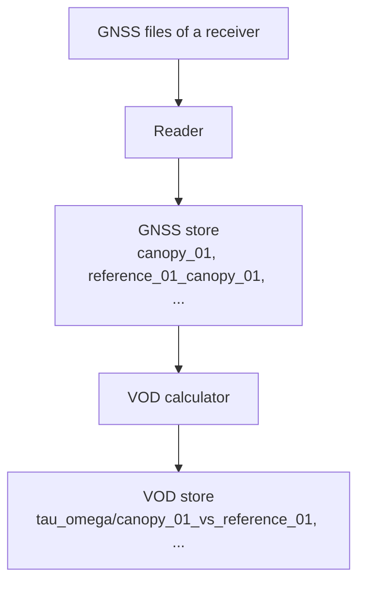

# canvod-store

`canvod-store` keeps the data of a site in two
[Icechunk](https://icechunk.io/) stores: the **GNSS store** holds the
observations of every receiver, and the **VOD store** holds the VOD
results. Icechunk stores Zarr arrays and records every write as a commit,
so earlier states of a store stay readable.

This page describes what the stores hold, how a run writes to them, and how
to read them in your own code.

## The two stores of a site

Each site has its own GNSS store and VOD store, both under
`processing.storage.stores_root_dir`:

```text
<stores_root_dir>/
└── ExampleSite/
    ├── rinex/   # GNSS store (processing.storage.gnss_store_name)
    └── vod/     # VOD store (processing.storage.vod_store_name)
```

The GNSS store holds data from every reader format (RINEX, SBF, and NMEA),
although its default directory name is `rinex`.

A store knows its site from its own metadata, not from the folder it
sits in: `store.site_name` stays the same when the folder is moved or
renamed. A store written before stores kept repository metadata has no
site name; reading it raises an error that names
`canvodpy store migrate-metadata`.



## Groups

A store holds one group per receiver, or per VOD analysis.

In the GNSS store:

- A canopy receiver has one group, named after the receiver, for example
  `canopy_01`.
- A reference receiver has one group per canopy receiver it is paired with,
  named `{reference}_{canopy}`, for example `reference_01_canopy_01`.

In the VOD store, a group is named `{calculator}/{analysis}`, for example
`tau_omega/canopy_01_vs_reference_01`.

The data variables of a GNSS store group (for example `SNR`, `Phase`,
`Pseudorange`, and `Doppler`, depending on the reader) have the dimensions
`epoch` and `sid` and sit directly in the group:

```text
canopy_01/
├── SNR
├── Phase
├── ...
└── metadata/
    ├── table     # log book: one row per stored file
    └── sbf_obs   # SBF receivers only: receiver metadata per file
```

The log book (`metadata/table`) records each stored file: its hash, start,
end, filename, the dataset attributes, and the preprocessing record (see
[Preprocessing during a run](../ops/overview.md#the-preprocessing-record)).
Every value in it is text, JSON, or a time.

## How a run writes

`canvodpy run` writes to both stores; in your own code, read from them.

On a file system, Icechunk can't detect two commits at the same time: both
can report success while Icechunk loses one of them
([Icechunk: storage](https://icechunk.io/en/stable/guides/storage/)). So
every commit to a store first takes the store's commit lock, the file
`.canvodpy-commit.lock` in the store directory. A commit from another
thread or process, for example a second run or a scheduler task, waits
until the lock is free. Write a store from one computer only.

Two Icechunk warnings don't apply to these stores, so canVODpy hides them:
that the file system is not safe for concurrent commits (the commit lock
covers this), and that a lost reply to a write may show up as a conflict
(Icechunk's file system storage makes one try per write and keeps no
write metadata). Every other Icechunk warning is shown. To set your own
filter, set the environment variable `ICECHUNK_LOG`, for example
`ICECHUNK_LOG=icechunk=debug`.

For each receiver and day, a run does the following:

1. Reads the files and computes the satellite angles.
1. Applies the preprocessing in `processing.preprocessing`, if set.
1. Checks each file against the group's log book (see
   [Duplicate checks](#duplicate-checks)).
1. Writes the new data with one commit. The same commit writes the
   snapshot summary and records the commit metadata (see
   [canvod-store-metadata](../store-metadata/overview.md)).

An append must match the group. A run stops with an error if:

- the data has other variables than the group
  (`GroupVariablesMismatchError`);
- the data has other `sid` labels than the group
  (`GroupCoordinatesMismatchError`). The labels are stored once per group,
  so an append with other labels, for example after you change
  `processing.params.aggregate_glonass_fdma`, would relabel the stored
  data;
- the epochs aren't in GPS time, or the group doesn't record its time
  scale (`EpochTimeSystemError`). Every stored epoch is GPS time
  (`epoch.attrs["time_system"] == "GPS"`). Groups written by canVODpy
  before it stored every epoch in GPS time have no record (their SBF and
  NMEA epochs were UTC, 18 s earlier); write to a new store.

If another commit lands while a write is in progress, canVODpy rebases the
write onto it when the two changed different groups. If both changed the
same data, the later commit fails with `icechunk.RebaseFailedError` and
writes nothing.

## Duplicate checks

Before a run writes a file, it checks the file against the group's log
book, in three ways:

| Check | What it finds | Where |
|---|---|---|
| Hash | The same file, already stored (SHA-256 of the file) | The orchestrator, and again in `append_to_group()` |
| Time span | A file whose time span overlaps stored data, also when it has another name or other start and end times | The orchestrator, and again in `append_to_group()` |
| Batch | Two files of one batch that cover the same time | The orchestrator |

A file that fails a check counts as already stored. The default write
strategy, `skip`, doesn't write it; `overwrite` replaces its time range.
For details, see [Write strategies](storage-strategies.md).

## Read a store

Open the stores of a configured site with `Site`:

```python
from canvodpy import Site

site = Site("ExampleSite")
site.gnss_store.list_groups()  # ["canopy_01", "reference_01_canopy_01"]
site.gnss_store.get_group_info("canopy_01")

ds = site.gnss_store.read_group("canopy_01")
ds_day = site.gnss_store.read_group("canopy_01", date="2025001")
ds_range = site.gnss_store.read_group(
    "canopy_01", time_slice=slice("2025-01-01", "2025-01-15")
)
```

`read_group()` returns an `xarray.Dataset` that reads its data only when a
value is needed. For more about reading, chunks, and earlier states of a
store, see [Versioning with Icechunk](icechunk.md).

To open a store by its path, use `open_gnss_store()` or
`open_vod_store()`:

```python
from canvod.store import open_gnss_store

store = open_gnss_store("/data/stores/ExampleSite/rinex")
```

Opening a store never creates one: a path without a store raises a
`FileNotFoundError` that names the path. A run creates a site's stores
when it first writes data, together with their metadata (see
[canvod-store-metadata](../store-metadata/overview.md)). `Site` opens its
stores only when you first use them, so a new site has no stores until a
run writes to it. `create_gnss_store()` and `create_vod_store()` are left
over from development: they open a store as well, and are removed with
the next major version.

## History

Each store keeps its commits and the operations on it:

```python
store = site.gnss_store

store.print_history(limit=20)  # commits on main, newest first
store.plot_commit_graph()  # commit graph: SVG in a notebook, text in a terminal
store.print_ops_log(limit=30)  # commits, branch operations, expiry, garbage collection

store.create_release_tag("v1.0")  # tag the latest commit on main
store.list_tags()
store.compare_snapshots(snapshot_id_1, snapshot_id_2)
```

## Command line

`canvodpy store` shows the stores of a configured site:

```bash
canvodpy store list                                 # GNSS and VOD store paths of every site
canvodpy store info ExampleSite                     # branches, groups, and statistics
canvodpy store info ExampleSite --group canopy_01   # the dataset and log book of one group
canvodpy store log ExampleSite                      # commit graph
canvodpy store log ExampleSite --ops                # operations on the store
canvodpy store maintain ExampleSite                 # what expiry and garbage collection would delete
```

`--store vod` opens the VOD store instead of the GNSS store, and `--branch`
selects a branch other than `main`. For every option, see the
[command-line reference](../../api/cli.md).

## Grids and analysis results

`store_grid()` writes a hemispherical grid to the `grids/{grid_name}` group
of a store, and `load_grid()` reads it back. A grid read back works for
cell assignment only if it's an equal-area, equal-angle, or equirectangular
grid; for the other grid types, build the grid again with
`create_hemigrid()`.

```python
from canvod.grids import create_hemigrid
from canvod.store import load_grid, store_grid

grid = create_hemigrid("equal_area", angular_resolution=4.0)
store_grid(grid, store, "equal_area_4deg")
grid = load_grid(store, "equal_area_4deg")
```

`AnalysisStorage` stores the results of an analysis on a grid in a VOD
store: weights, masks, statistics, and time series per cell. The time
series per cell go to the `per_cell` branch, one dataset per system, band,
and code:

```python
from canvod.store import AnalysisStorage

storage = AnalysisStorage("/path/to/vod_store")
storage.store_percell_timeseries(percell_ds, system="G", band="L1", code="C")
storage.list_percell_datasets()  # ['C_B2b_I', 'E_E1_C', 'G_L1_C', ...]
ds = storage.load_percell_timeseries(system="G", band="L1", code="C")
```

## Next steps

- [Versioning with Icechunk](icechunk.md): the store format, chunks, the
  Icechunk settings, and reading earlier states.
- [Write strategies](storage-strategies.md): what a run does with a file
  that's already stored.
- [canvod-store-metadata](../store-metadata/overview.md): the metadata that
  describes a whole store.
