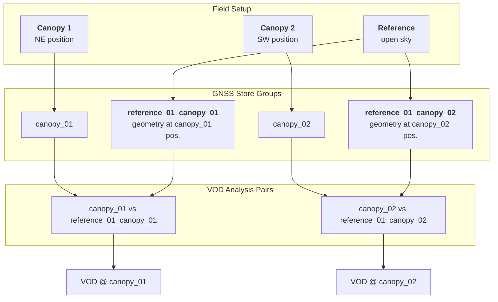

# canvod-vod

## Purpose

The `canvod-vod` package implements vegetation optical depth (VOD) estimation from GNSS signal-to-noise ratio (SNR) data. It provides the core scientific algorithms for the canVODpy analysis pipeline.

---

## Physical background

!!! abstract "Tau-Omega Radiative Transfer Model"

    canvod-vod implements the **zeroth-order tau-omega** model for [GNSS-Transmissometry](https://gssc.esa.int/navipedia/index.php/GNSS){:target="_blank"},
    following [Humphrey & Frankenberg (2022)](https://doi.org/10.1016/j.rse.2022.113208){:target="_blank"}.

    A reference receiver in open sky and a canopy receiver beneath vegetation observe
    the same satellite at [polar angle](https://gssc.esa.int/navipedia/index.php/Transformations_between_ECEF_and_ENU_coordinates){:target="_blank"} $\theta$. The SNR difference encodes the two-way
    canopy attenuation:

    $$\Delta\text{SNR} = \text{SNR}_\text{canopy} - \text{SNR}_\text{reference}$$

    $$T = 10^{\Delta\text{SNR} / 10} \qquad \text{(linear transmissivity)}$$

    $$\text{VOD} = -\ln(T) \cdot \cos\theta$$

    Assumptions:
    - Single-scattering approximation (no multiple canopy reflections)
    - Plane-parallel canopy layer
    - Attenuation proportional to path length through canopy

---

## Usage

In a run, VOD is computed by `VodComputer` (`Site(site).vod`, `canvodpy run`,
`canvodpy vod`): it picks the configured canopy/reference pairs and days, calls the
calculator and writes the VOD store. Use the calculator directly only for your own
analyses.

=== "Direct instantiation"

    ```python
    from canvod.vod import TauOmegaZerothOrder

    calculator = TauOmegaZerothOrder(canopy_ds=canopy_ds, sky_ds=sky_ds)
    vod_result = calculator.calculate_vod()
    ```

=== "From two datasets"

    ```python
    from canvod.vod import TauOmegaZerothOrder

    # Aligns both datasets on their shared epochs and signals
    vod_result = TauOmegaZerothOrder.from_datasets(
        canopy_ds=canopy_ds,
        sky_ds=sky_ds,
    )
    ```

=== "From the GNSS store"

    ```python
    from datetime import datetime

    from canvodpy import Site

    # Reads the pair from the site's GNSS store and writes the VOD store
    # (pass write=False to skip the write)
    vod_result = Site("ExampleSite").vod.compute_bulk(
        "canopy_01_vs_reference_01",
        start=datetime(2025, 1, 1),
        end=datetime(2025, 1, 31, 23, 59, 59),
    )
    ```

!!! info "Input requirements"

    Both datasets must contain an `SNR` data variable on `(epoch, sid)`, and the
    canopy dataset the polar angle `theta` (radians) from `canvod-auxiliary`.
    The result passes `canvod.readers.validate_vod_dataset`, which the VOD store
    checks on every write.

---

## Output

`calculate_vod()` returns an `xr.Dataset` containing:

| Variable | Description |
| -------- | ----------- |
| `VOD` | Vegetation optical depth |
| `phi` | Azimuth angles (from canopy dataset) |
| `theta` | Polar angles (from canopy dataset) |

---

## One reference receiver, several canopy receivers

When a single reference receiver serves multiple canopy positions, satellite geometry must be recomputed relative to each canopy location. The `paired_canopies` field in `canvod-settings.yaml` (`sites.<name>.receivers.<ref>.paired_canopies`) drives this: the reference data is stored once per paired canopy, in the group `{reference}_{canopy}`.



!!! note "Configuration"

    ```yaml
    # config/canvod-settings.yaml (sites.<name>.receivers)
    receivers:
      reference_01:
        type: reference
        paired_canopies:   # or: all
          - canopy_01    # recompute geometry at canopy_01 position
          - canopy_02    # recompute geometry at canopy_02 position
    ```

---

## Your own VOD model

A VOD calculator of your own inherits `VODCalculator` and implements
`calculate_vod()`. Installed as a plugin package, it is a choice of
`canvodpy run --vod-calculator`; see
[Your Own Readers and VOD Calculators](../../guides/plugins.md).

---

## References

Humphrey, V. and Frankenberg, C. (2022). GNSS-transmissometry: A new approach for vegetation optical depth estimation. *Remote Sensing of Environment*.
